# İstifadəçi bələdçisi (klinika işçiləri üçün)

> Bu bələdçi **bu gün işləyən** ekranları təsvir edir. Ekran görüntüləri real sistemdən (saxta ad və telefonlarla) çəkilib (`frontend/apps/web/scripts/capture-docs.mjs`). Hələ olmayan imkanlar [STATUS.md](../STATUS.md)-dədir: bu bələdçidə vəd edilmir.

## 1. Daxil olmaq

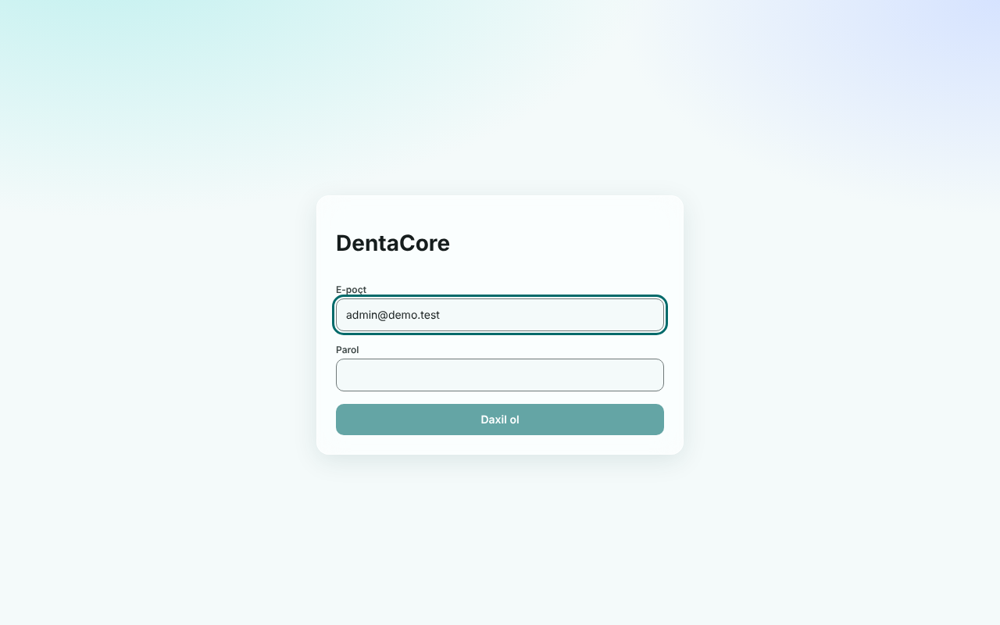

1. Klinikanızın ünvanını açın (məs. `klinikam.dentacore.app`). Tək-klinika qurulumunda ünvanı IT məsuliyyətlisi verir.
2. E-poçt və parolu yazın, **Daxil ol** düyməsini basın. Hər iki sahə dolmayana qədər düymə qeyri-aktivdir.
3. Səhv parol halında ümumi mesaj görürsünüz ("E-poçt və ya parol yanlışdır"): sistem hansının səhv olduğunu qəsdən demir. Ardıcıl uğursuz cəhdlərdən sonra hesab müvəqqəti bloklanır ("Hesab müvəqqəti bloklanıb"): bir qədər gözləyin və ya rəhbərliyə müraciət edin.
4. **Çıxış** düyməsi sessiyanı bu cihazda bağlayır. Ortaq kompüterdə işi bitirəndə həmişə çıxış edin.

İki mərhələli doğrulama (2FA) olan hesablar üçün giriş ekranı hələ tamamlanmayıb: bu hesablarla daxil ola bilməzsiniz ([STATUS](../STATUS.md)).

## 2. Naviqasiya və rollar

Sol menyuda yalnız **rolunuzun görə biləcəyi** bölmələr var. Menyu sadəcə rahatlıqdır: əsl yoxlama serverdədir, ona görə adres sətrinə əl ilə yazmaq icazəsiz məlumatı açmır (403 alırsınız).

| Bölmə | Lazım olan icazə |
|---|---|
| İdarə paneli | `report:read` |
| Pasiyentlər | `patient:read` |
| Təqvim | `appointment:read` |
| Maliyyə | `invoice:read` |

Rolun **hansı səviyyədə** (scope) işləməsi də vacibdir: `own` yalnız öz pasiyent/qəbulları, `branch` öz filialı, `tenant` bütün klinika.

### Hazırda işləyən rollar və icazələri

Aşağıdakı cədvəl bazadakı başlanğıc (seed) icazələrdən avtomatik çıxarılıb (`·` = icazə yoxdur):

| icazə | cashier | clinic_admin | director | doctor | reception |
|---|---|---|---|---|---|
| appointment:read | · | tenant | tenant | own | branch |
| appointment:write | · | tenant | tenant | · | branch |
| audit:read | · | tenant | tenant | · | · |
| clinical:read | · | tenant | tenant | own | · |
| clinical:write | · | tenant | tenant | own | · |
| invoice:read | branch | tenant | tenant | own | branch |
| invoice:refund | branch (limit 0.00) | tenant | tenant | · | · |
| invoice:write | branch | tenant | tenant | · | · |
| patient:export | · | tenant | tenant | · | · |
| patient:read | · | tenant | tenant | own | branch |
| patient:read_sensitive | · | tenant | tenant | own | branch |
| patient:write | · | tenant | tenant | · | branch |
| payment:write | branch | tenant | tenant | · | branch |
| prescription:write | · | tenant | tenant | own | · |
| report:read | · | tenant | tenant | · | · |
| settings:manage | · | tenant | tenant | · | · |
| user:manage | · | tenant | tenant | · | · |

**Diqqət:** `manager`, `hygienist`, `lab`, `radiology`, `finance` rolları sistemdə **mövcuddur, amma heç bir icazəsi yoxdur**: bu rollarla daxil olan istifadəçi heç nə görə bilməz. Rolların icazələrini klinika üçün təyin etmək hələ yalnız verilənlər bazası səviyyəsində mümkündür (idarəetmə ekranı yoxdur). Kassirin geri qaytarma limiti 0-dır: kassir ödəniş qəbul edir, amma geri qaytara bilmir.

Reception rolu ilə daxil olanda menyu belə görünür (İdarə paneli yoxdur, sistem ilk əlçatan bölməyə yönləndirir):

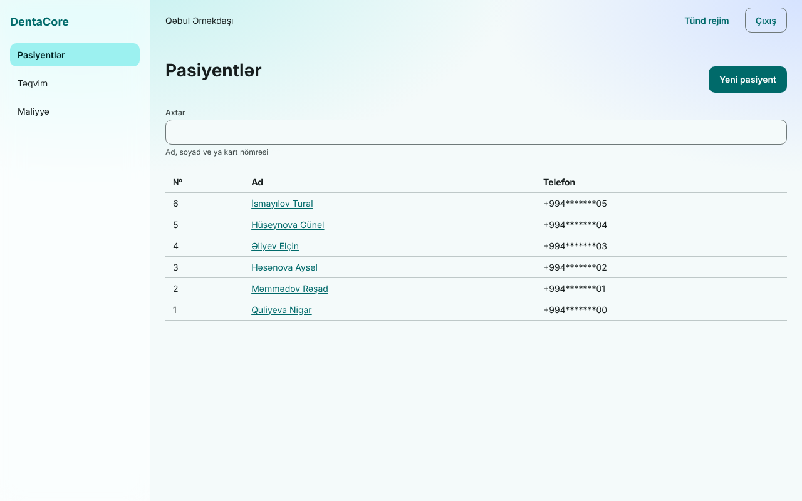

## 3. İdarə paneli

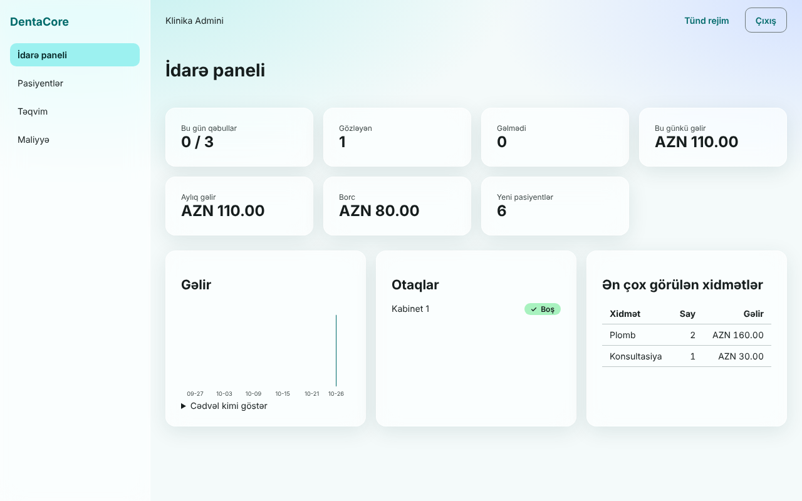

Kartlar: bu günün qəbulları (tamamlanan / cəmi), gözləyənlər, gəlməyənlər, bu günkü və aylıq gəlir, borc, yeni pasiyentlər. Aşağıda 30 günlük gəlir qrafiki, otaqların vəziyyəti və ən çox görülən xidmətlər.

- Qrafikin altındakı **Cədvəl kimi göstər** eyni rəqəmləri cədvəl şəklində verir (ekran oxuyucu istifadəçiləri üçün də).
- Rəqəmlər real vaxtda yenilənir: kimsə ödəniş qəbul edəndə və ya qəbul dəyişəndə panel özü təzələnir. Bağlantı kəsilsə panel işləməyə davam edir, amma avtomatik yenilənmir (səhifəni yeniləyin).
- Bütün vaxtlar klinikanın yerli günü ilə hesablanır.
- Tünd rejim üçün yuxarıdakı **Tünd rejim** düyməsi (seçim brauzerdə yadda qalır; yoxdursa cihazın seçimi istifadə olunur):

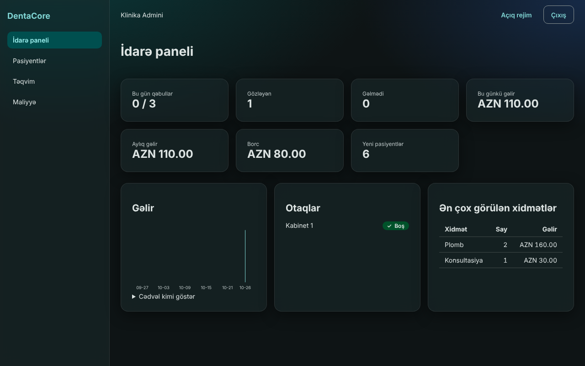

## 4. Pasiyentlər

### Axtarış

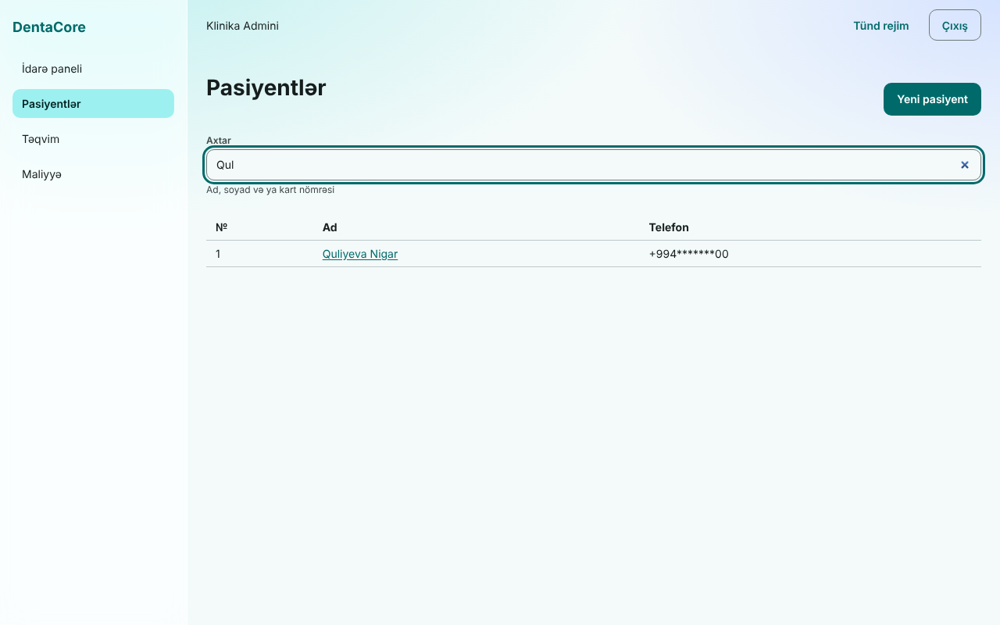

Axtarış yerinə yazdıqca (qısa gecikmə ilə) işləyir: **ad, soyad, ata adı və ya kart nömrəsi**. Elasticsearch işləyirsə hərf səhvinə dözümlüdür və ə/ı/ö/ü/ş/ç/ğ hərflərini latın əsasına qatlayır (`gunel` → `Günel`). Əgər axtarış mühərriki müvəqqəti əlçatmazdırsa sistem **avtomatik** adi axtarışa keçir: fərqi görmürsünüz, amma yazılış dəqiq olmalıdır. **Telefon və FİN ilə axtarış bu ekranda etibarlı deyil:** server adi (SQL) axtarışında onları şifrəli indeks vasitəsilə *dəqiq* uyğunluqla tapa bilir, amma ekran Elasticsearch işləyəndə yalnız ad üzrə axtarır. Telefonla pasiyent tapmaq lazımdırsa ad və ya kart nömrəsindən istifadə edin ([STATUS](../STATUS.md)). Siyahı uzundursa **Daha çox** düyməsi var.

### Yeni pasiyent

**Yeni pasiyent** düyməsi (`patient:write` lazımdır): ad və soyad məcburidir, qalanı könüllüdür. Telefonu `+994501234567` formatında yazın (boşluq və tire silinir).

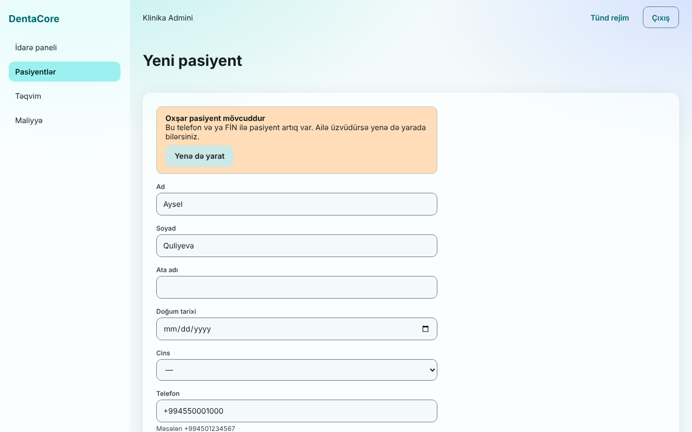

Eyni telefon və ya FİN ilə pasiyent varsa sistem xəbərdarlıq edir. Bu **xəta deyil, sizin qərarınızdır**: ailə üzvləri tez-tez eyni telefonu paylaşır. Ailə üzvüdürsə **Yenə də yarat** düyməsi ilə yaradın; əks halda mövcud pasiyenti axtarışla tapın. (Xəbərdarlıq hələ *hansı* pasiyentlə uyğunluq olduğunu göstərmir: [STATUS](../STATUS.md).)

### Pasiyent kartı

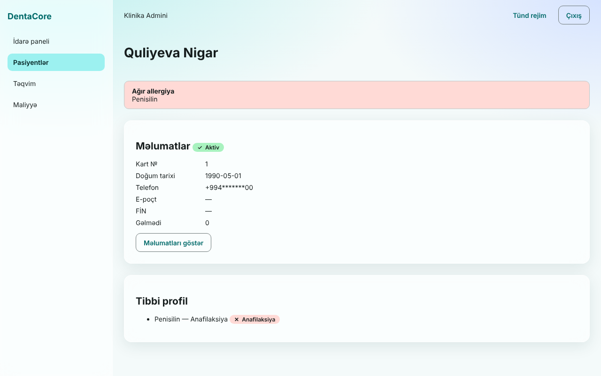

- **Ağır allergiya** olduqda kartın başında qırmızı xəbərdarlıq çıxır. Bu, resept və müalicə qərarından əvvəl ilk baxılan yerdir.
- Telefon, e-poçt və FİN **default maskalıdır** (`+994*******00`). Tam dəyər görmək üçün **Məlumatları göstər** (`patient:read_sensitive` lazımdır):

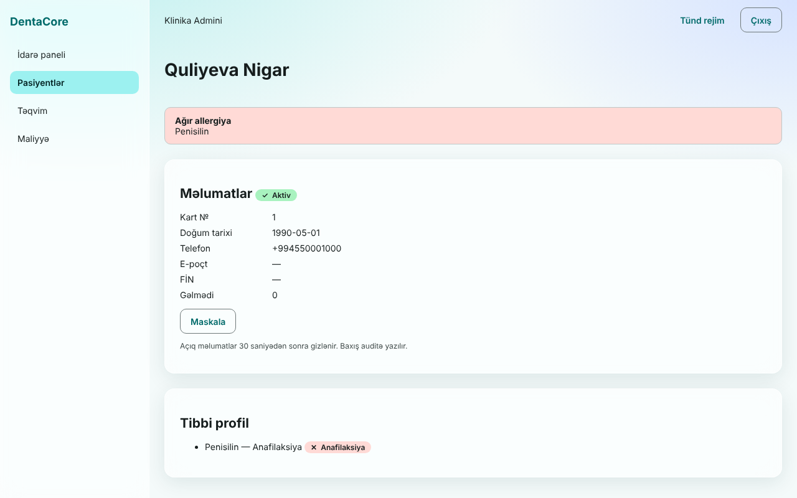

  Açıq məlumat **30 saniyədən sonra özü gizlənir** və hər açılış **audit jurnalına yazılır** (kim, kimin məlumatını, nə vaxt). Yalnız lazım olanda açın.
- **Tibbi profil** bölməsi (`clinical:read`) allergiyaları göstərir. Allergiya əlavə etmək, odontoqram, müalicə planı və klinik qeydlər üçün **ekranlar hələ yoxdur** (API var).

## 5. Təqvim

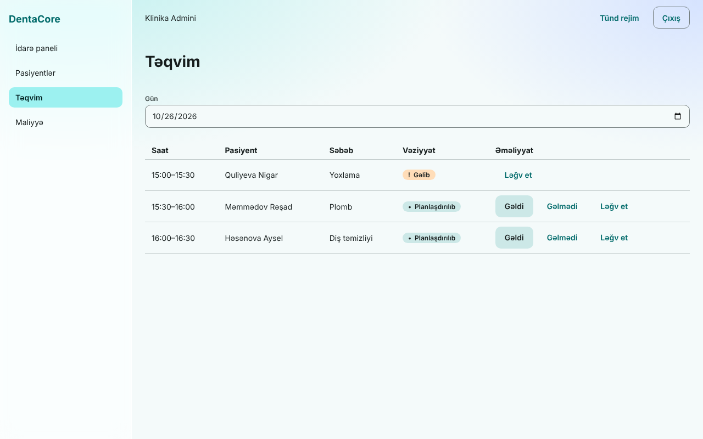

Seçilmiş günün qəbulları vaxt sırası ilə: saat, pasiyent, səbəb, vəziyyət, əməliyyatlar. Vəziyyət həm **simvol**, həm mətn ilə göstərilir (yalnız rəngə güvənilmir).

| Düymə | Nə edir | Qeyd |
|---|---|---|
| **Gəldi** | Check-in: pasiyentə növbə nömrəsi verilir | Qəbula **2 saat qalmışdan** başlayır; tez gəlmək xəta verir ("Check-in vaxtı keçib və ya hələ başlamayıb") |
| **Gəlmədi** | No-show: pasiyentin gəlməmə sayı artır | Qəbul başlamamış edilə bilməz |
| **Ləğv et** | Qəbulu ləğv edir | |

Düymələr yalnız `appointment:write` olanlara görünür və yalnız vəziyyətə uyğun olanlar çıxır (tamamlanmış qəbulda düymə yoxdur). Gün seçimi üçün sahədən istifadə edin.

**Hələ yoxdur:** təqvimdən yeni qəbul yaratmaq, qəbulu sürüşdürüb vaxtını dəyişmək, həkimlər üzrə sütunlar. Qəbul yaratmaq hazırda yalnız API ilə mümkündür ([api-guide](api-guide.md) §6).

## 6. Maliyyə

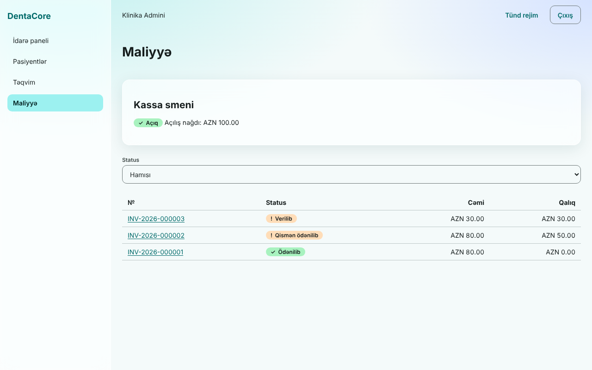

**Kassa smeni:** nağd ödəniş qəbul etmək üçün əvvəlcə kassir öz smenini açmalıdır (**Smeni aç**). Smen açıq deyilsə nağd ödəniş "Nağd ödəniş üçün əvvəlcə kassa smenini açın" xətası verir. Kart/POS/köçürmə ödənişləri smensiz keçir. Smeni **bağlamaq üçün ekran yoxdur** (API var).

**Fakturalar:** siyahı status filtri ilə. Faktura nömrəsinə basıb detala keçirsiniz.

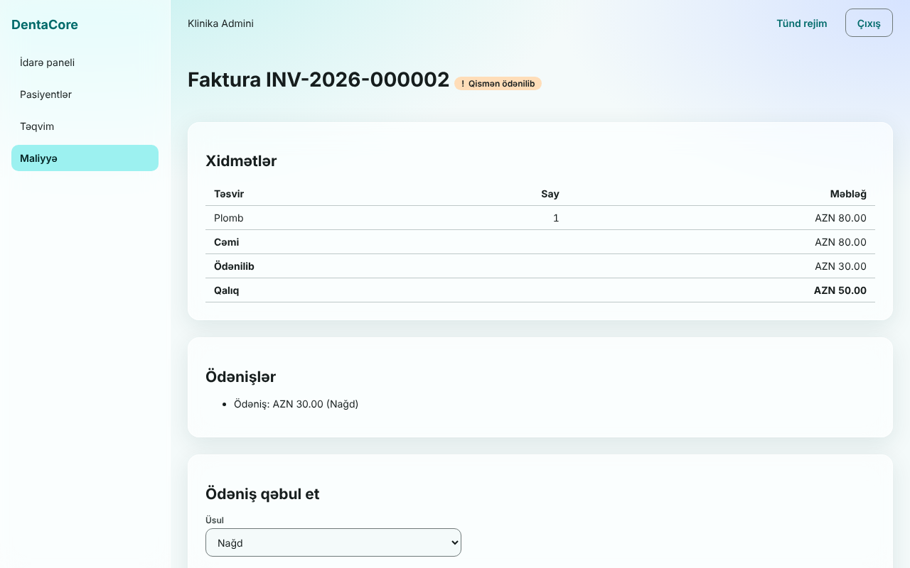

**Ödəniş qəbul etmək** (`payment:write`; faktura *verilmiş* və ya *qismən ödənilmiş* olmalıdır):

1. Üsulu seçin (Nağd, Kart, POS, Köçürmə).
2. Məbləği yazın (boş qalsa tam qalıq). `12,50` və `12.50` qəbul olunur; ikidən çox onluq rəqəm və qalıqdan çox məbləğ göndərilməzdən əvvəl rədd olunur.
3. **Qəbul et**.

**Şəbəkə kəsilsə və ya "Ödəniş alınmadı" görsəniz:** eyni düyməni təkrar basmaq **təhlükəsizdir**. Hər cəhd gizli bir açar daşıyır, ona görə ödəniş iki dəfə çıxılmır. Əmin deyilsinizsə əvvəl fakturanı yeniləyib "Ödənişlər" siyahısına baxın.

**Hələ yoxdur:** faktura yaratmaq/vermək/ləğv etmək ekranı, geri qaytarma ekranı, smeni bağlamaq.

## 7. Məxfilik qaydaları (bütün işçilər üçün)

- Pasiyentin telefon/FİN məlumatını yalnız **işiniz tələb edəndə** açın: hər açılış izlənir.
- Ekranı başqasına göstərməyin; 30 saniyə qaydası təsadüfi açıq qalmanın qarşısını alır, amma çiyin üstündən baxmanı yox.
- Parolunuzu paylaşmayın. Hər əməliyyat sizin adınıza yazılır.
- Ortaq kompüterdə **Çıxış** edin.

Texniki təfərrüat: [security-and-privacy.md](security-and-privacy.md).

## 8. Tez-tez rast gəlinən mesajlar

| Mesaj | Nə etməli |
|---|---|
| "Bu əməliyyat üçün icazəniz yoxdur" | Rolunuzun bu işə icazəsi yoxdur: rəhbərliyə müraciət edin |
| "Qeyd başqa istifadəçi tərəfindən dəyişdirilib. Səhifəni yeniləyin." | Eyni qeydi başqası da redaktə edib: yeniləyin və təkrar edin |
| "Çox sayda sorğu. Bir az gözləyin." | Qısa müddət gözləyin (sistem sürətə məhdudiyyət qoyur) |
| "Sizə filial təyin olunmayıb." | İstifadəçiyə heç bir filial verilməyib: IT/rəhbərliyə müraciət |
| Giriş etmədən səhifə "Giriş" ekranına qayıdır | Sessiya bitib: yenidən daxil olun |
